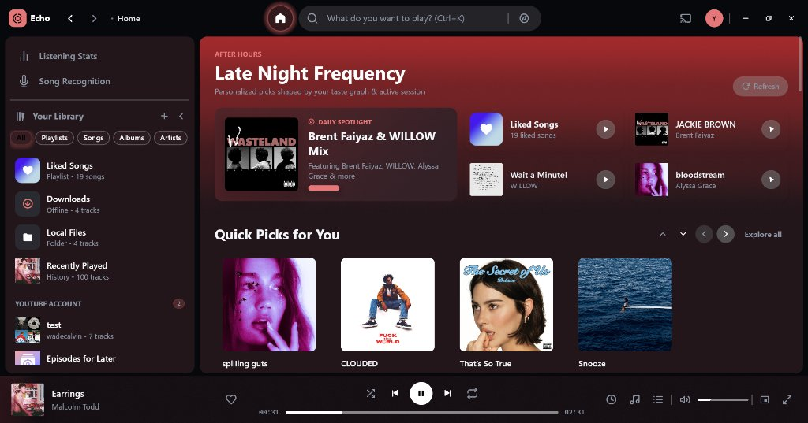
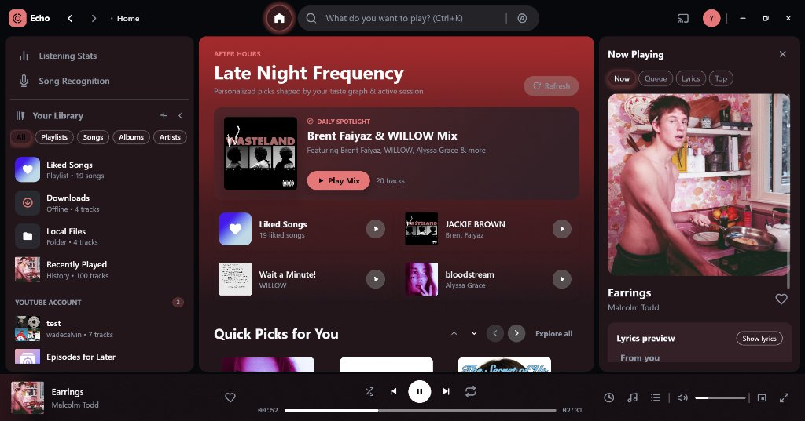
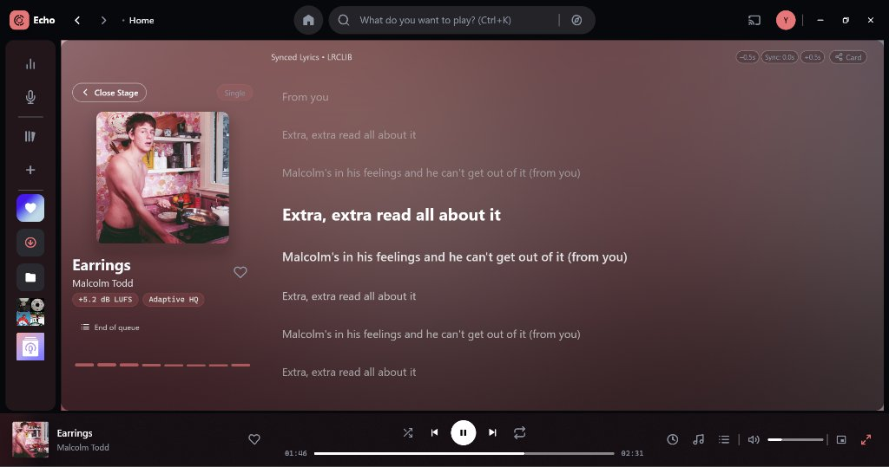
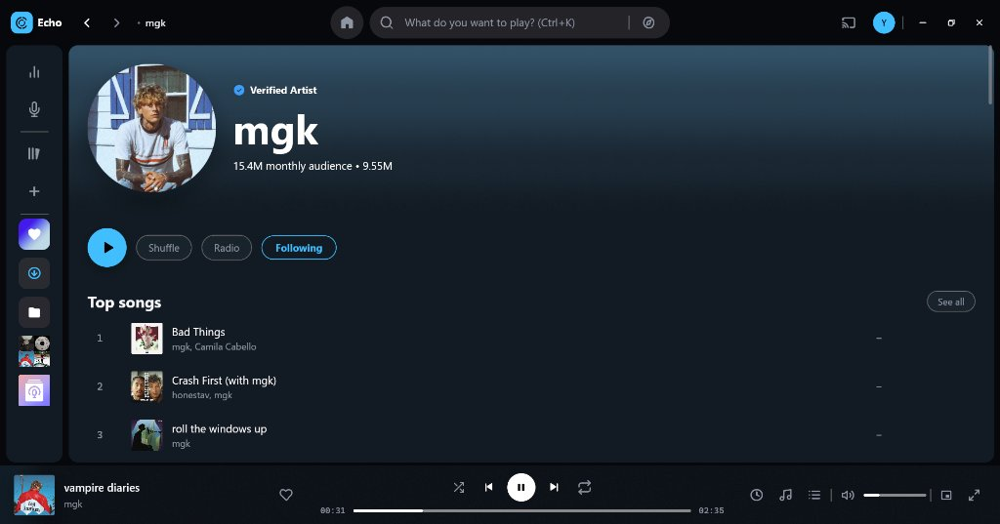
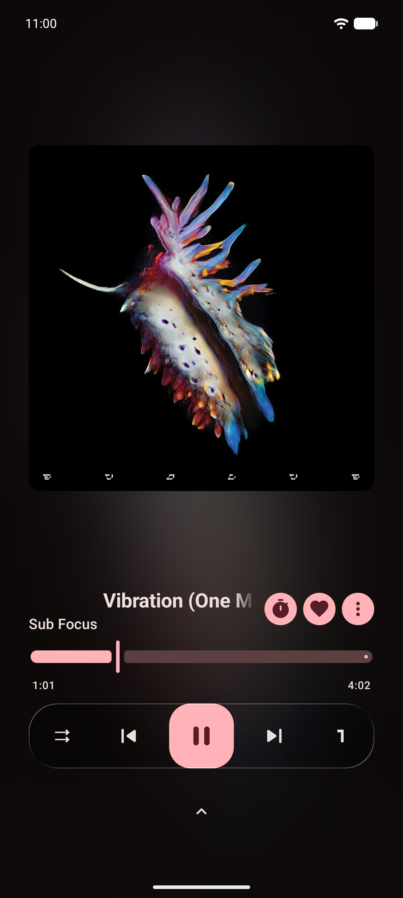
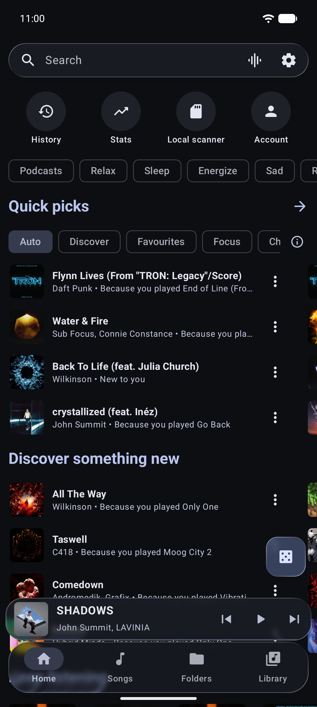
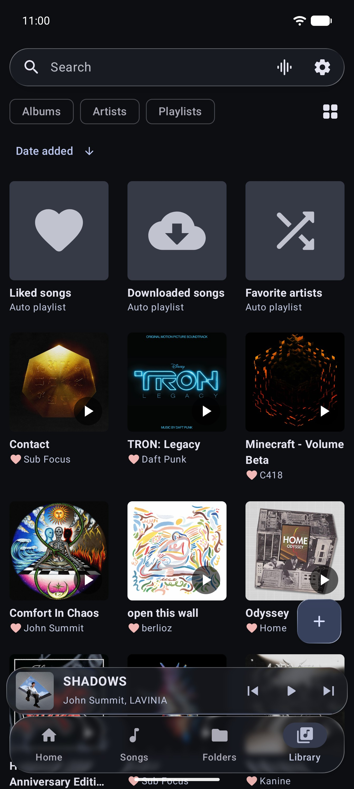
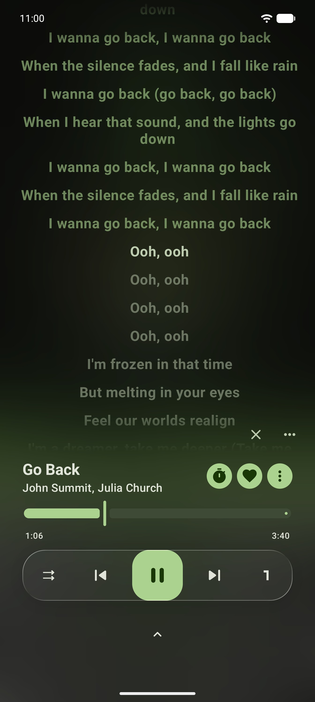

<div align="center">


# Echo

### Pure-Rust Desktop & Lightweight Android YouTube Music & Local Audio Player

[](https://github.com/wadecalvin9/echo-releases/releases/latest)
[](https://github.com/wadecalvin9/echo-releases/releases/latest)
[](https://github.com/wadecalvin9/echo-releases/releases/latest)
[](https://www.gnu.org/licenses/gpl-3.0)
[](https://github.com/wadecalvin9)

<p align="center">
  <a href="#downloads"><b>[ Downloads ]</b></a> •
  <a href="#desktop-screenshots">Desktop Screenshots</a> •
  <a href="#android-screenshots">Android Screenshots</a> •
  <a href="#features">Features</a> •
  <a href="#installation-guides">Installation</a> •
  <a href="#about--creator">Creator</a>
</p>

</div>

---

## Overview

**Echo** is a modernized, distraction-free music player ecosystem tailored for streaming YouTube Music and playing your personal offline music library. Available as a high-performance **Desktop application (Windows x64)** written in pure Rust (Iced + Tokio + Symphonia) and as a battery-efficient **Android application** (Jetpack Compose).

No accounts mandatory. No tracking. No advertisements. Just instant, bit-perfect music.

---

## Downloads

### Latest Releases

| Package | Platform | Details | Direct Download |
| :--- | :--- | :--- | :--- |
| **Echo Desktop Installer (Recommended)** | Windows 10 / 11 (64-bit) | Standard Windows setup installer with Start Menu & Desktop shortcuts | **[Download Echo-Setup-v1.0.4.exe](https://github.com/wadecalvin9/echo-releases/releases/download/v1.0.4/Echo-Setup-v1.0.4.exe)** • [View in Repo](Echo-Setup-v1.0.4.exe) |
| **Echo Desktop Portable Zip** | Windows 10 / 11 (64-bit) | Portable zip (standalone, all DLLs included) | **[Download Echo-Desktop-Windows-x64.zip](https://github.com/wadecalvin9/echo-releases/releases/download/v1.0.4/Echo-Desktop-Windows-x64.zip)** • [View in Repo](Echo-Desktop-Windows-x64.zip) |
| **Echo Android (Universal APK)** | Android 7.0+ (API 24+) | Supports `arm64-v8a`, `armeabi-v7a`, `x86`, `x86_64` | **[Download Echo-1.0.3-core-release-4.apk](https://github.com/wadecalvin9/echo-releases/releases/download/v1.0.4/Echo-1.0.3-core-release-4.apk)** |

---

## Desktop Screenshots

<div align="center">

### Home & Discover


<br/><br/>

### Now Playing & Queue


<br/><br/>

### Cinema Synced Lyrics Stage


<br/><br/>

### Artist Discography & Top Songs


</div>

---

## Android Screenshots

<div align="center">
  
  &nbsp;
  
  &nbsp;
  
  &nbsp;
  
</div>

<p align="center">
  <sub>Left to right: Home & Quick Picks • Now Playing with Swipe Controls • Cinema Synced Lyrics • Local & Streamed Library</sub>
</p>

---

## Features

### Echo Desktop (Windows x64)
- **Spotify Desktop-Style Navigation:** Dedicated circular Home button alongside a capsule search bar with embedded Explore/Browse icon.
- **Pure Rust Audio Pipeline:** Symphonia + CPAL engine with Echo loudness leveling (`-3 dB` reference), `+12 dB` soft-clipped limiter, 10-band custom graphic EQ, and Harman AutoEQ headphone profiles.
- **Cinema-Style Synced Lyrics Stage:** Live synchronized lyrics from LRCLIB, KuGou, and Better Lyrics (TTML), click-to-seek, auto-scroll, romanization, and audio waveform strip.
- **Song Recognition (Shazam / SongRec):** 16 kHz mono audio fingerprinting via **WASAPI loopback** or microphone to recognize music playing anywhere on your PC.
- **Offline Downloads & Local Library:** Disk LRU stream cache, offline download manager, and local audio folder indexing (`lofty` tags).
- **Frameless Reactive Dark Theme:** Custom titlebar, minimize/maximize/close, and dynamic album-art colors (`Dynamic`, `Dark`, `OLED Black`).
- **Integrations:** Last.fm scrobbling, Windows System Media Transport Controls (SMTC), and taskbar playback progress.

### Echo for Android
- **Ultra-Fast Cold Start:** Launches immediately into your music without modal popups or onboarding hurdles.
- **MiniPlayer Gestures:** Natural swipe gestures with elastic resistance to skip tracks.
- **True Black OLED Mode:** High-contrast zinc/charcoal dark palette optimized for battery efficiency.
- **Multi-Provider Synced Lyrics:** Live time-synced lyrics with automatic fallback.
- **In-App Updater:** Automatic update notifications and one-tap in-app installation.
- **Lightweight & Private:** Zero tracking, no background analytics, minimal battery consumption.

---

## Installation Guides

### Desktop (Windows 10 / 11)
**Standard Installation (Recommended):**
1. Download **`Echo-Setup-v1.0.4.exe`** from [Direct Download](https://github.com/wadecalvin9/echo-releases/releases/download/v1.0.4/Echo-Setup-v1.0.4.exe).
2. Run the installer. It will automatically install Echo, configure all runtime libraries, and create Start Menu and Desktop shortcuts.
3. Launch Echo and start playing!

**Portable Zip:**
1. Download **`Echo-Desktop-Windows-x64.zip`** from [Direct Download](https://github.com/wadecalvin9/echo-releases/releases/download/v1.0.4/Echo-Desktop-Windows-x64.zip).
2. Extract the archive into any folder.
3. Run **`echo-app.exe`** directly (all runtime libraries `libunwind.dll` and `WebView2Loader.dll` are included).

### Android (APK)
1. Tap the download link above on your Android phone to get **`Echo-1.0.3-core-release-4.apk`**.
2. When the download finishes, open the `.apk` file.
3. If prompted by Android, enable **"Allow installation from this source"** for your browser or file manager.
4. Tap **Install** and enjoy!

---

## Verification & Checksums

To verify the integrity of your download:

```text
Package: Echo-1.0.3-core-release-4.apk
SHA-256: 6846581996e930176a7a668fa418d9d9f75b5842b20e192606d4c2984a8aa3e7
Signature: Android APK Signature Scheme v2 (Verified)
```

---

## About & Creator

- **Lead Developer & Creator:** [wadecalvin9](https://github.com/wadecalvin9)
- **Desktop Repository:** [Echo-desktop](https://github.com/wadecalvin9/Echo-desktop)
- **Releases Repository:** [echo-releases](https://github.com/wadecalvin9/echo-releases)
- **License:** GNU General Public License v3.0 (GPL-3.0-or-later)

---

<div align="center">
  <sub>Built with ❤️ by wadecalvin9 for music enthusiasts worldwide.</sub>
</div>
